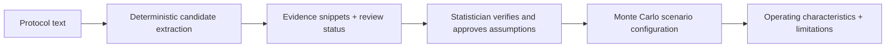

# Clinical Trial Simulation & Agentic Assumption Review

A transparent, reproducible research prototype for **Monte Carlo trial design simulation** and **human-reviewed extraction of candidate assumptions from protocol text**. It is tailored to the clinical-trial simulation and AI-assisted workflow priorities in the two Boehringer Ingelheim gBDS / Med Data-AI job descriptions (IDs 38743 and 31802).

> **Important scope:** This repository uses synthetic data only. It is a portfolio/teaching prototype, not a validated clinical, statistical, regulatory, or medical decision tool. Extracted assumptions are candidates for qualified human review, not approved model inputs. Do not use outputs to plan or operate a real clinical trial.

## Why this project

Clinical trial performance depends on both statistical design and operational realities. This package demonstrates a reproducible approach to:

- Evaluate simulated operating characteristics under assumptions about effect size, endpoint variability, dropout, nonadherence, and simplified site heterogeneity.
- Preserve exact evidence snippets when extracting candidate trial parameters from text.
- Keep a clear human approval gate between extraction and simulation.
- Report uncertainty in estimated empirical power through Monte Carlo standard error.

## Workflow



The current first version intentionally uses deterministic, inspectable regular expressions rather than an LLM. This makes the evidence-to-candidate relationship auditable. A future LLM adapter can be evaluated against the same evidence, review, and validation contract; it must not silently approve assumptions or automatically trigger confirmatory analyses.

## Install

```bash
git clone https://github.com/gyagu98/clinical-trial-simulation-agent.git
cd clinical-trial-simulation-agent
python -m venv .venv
source .venv/bin/activate  # Windows: .venv\Scripts\activate
python -m pip install -e '.[dev]'
```

## Run a synthetic simulation

```bash
trial-sim simulate \
  --name demonstration \
  --n-per-arm 120 \
  --effect 0.3 \
  --sd 1.0 \
  --dropout 0.10 \
  --nonadherence 0.05 \
  --site-heterogeneity-sd 0.10 \
  --missingness MCAR \
  --n-simulations 2000 \
  --seed 42 \
  --out results/demo_simulation.json
```

This command estimates power for a simple two-arm continuous endpoint using a Welch t-test. It is **not** a survival, longitudinal, Bayesian, interim, or regulatory-grade trial simulation.

## Extract candidate protocol assumptions

```bash
trial-sim extract \
  --protocol tests/fixtures/sample_protocol.txt \
  --out results/protocol_review_packet.json
```

The extractor currently recognizes candidate target enrollment, dropout/withdrawal percentage, follow-up duration, randomization ratio, and primary endpoint text. Every candidate includes an evidence snippet, character offsets, an uncalibrated confidence label, and a required human-review status. Unmatched values remain absent; the tool does not guess.

## Validate locally

```bash
pytest -q
ruff check src tests
```

GitHub Actions runs tests and linting on supported Python versions.

## Model assumptions and limitations

- Simulated participants are generated from simple normal distributions; no real patient data are included.
- The treatment contrast is an analyst-specified mean difference, not estimated from data.
- Dropout/missingness is simplified; the `MNAR` setting is a stress-test knob, not a principled MNAR model or correction method.
- Site heterogeneity is a simple random mean shift, not a calibrated hierarchical site model.
- Nonadherence is represented by effect dilution in the demonstration, not a causal estimand method.
- There is no covariate adjustment, survival endpoint, longitudinal model, Bayesian prior, interim analysis, adaptive design, or multiplicity control in v0.1.
- Empirical power is subject to Monte Carlo error; outputs include its estimated standard error.

## Responsible AI & human oversight

- This initial implementation has no LLM and does not make autonomous decisions.
- Candidate fields retain source evidence and are always marked `requires_human_review`.
- A qualified statistician or trial expert must verify each proposed assumption before a scenario is configured.
- Any future LLM integration should be benchmarked for extraction accuracy, unsupported claims, reproducibility, and failure modes, with explicit human approval gates.

## Repository structure

```text
src/trial_sim/
  agent/        # Protocol candidate extraction and review packet
  simulation/   # Scenario validation and Monte Carlo engine
  cli.py        # Command-line interface
tests/          # Unit tests and synthetic protocol fixture
examples/       # Example scenario settings
```

## Citation and attribution

Developed as a portfolio project to demonstrate reproducible statistical programming, simulation design, transparent assumptions, and responsible human-in-the-loop AI workflow design. The included synthetic examples are not sourced from clinical trials. Cite the repository version and environment if reusing code; independently validate all methods before research use.

## License

MIT. See [LICENSE](LICENSE).

## Generate a reproducible HTML report

Every simulation creates both a machine-readable JSON result and a self-contained HTML report with scenario assumptions, empirical power and Monte Carlo uncertainty, planned and retained sample-size/dropout summaries, and sensitivity plots for effect size, sample size, and dropout rate. The report embeds its plot as a base64 image and records the UTC generation time and random seed.

```bash
trial-sim simulate \
  --name demonstration \
  --n-per-arm 120 \
  --effect 0.3 \
  --sd 1.0 \
  --dropout 0.10 \
  --n-simulations 2000 \
  --seed 42 \
  --out results/demo_simulation.json \
  --report results/demo_report.html
```

Generate a report later from an existing simulation result:

```bash
trial-sim report \
  --result results/demo_simulation.json \
  --out results/demo_report.html
```

By default the report is saved beside the JSON file with an `.html` extension; `--report` overrides that path. For faster report generation, `--no-sensitivity` skips the sensitivity simulations and plots. Each sensitivity scenario uses the configured deterministic random seed; generating the report does not alter the original JSON simulation output. All generated reports include a prominent research-prototype disclaimer. They are not validated for clinical, medical, or regulatory decisions.
